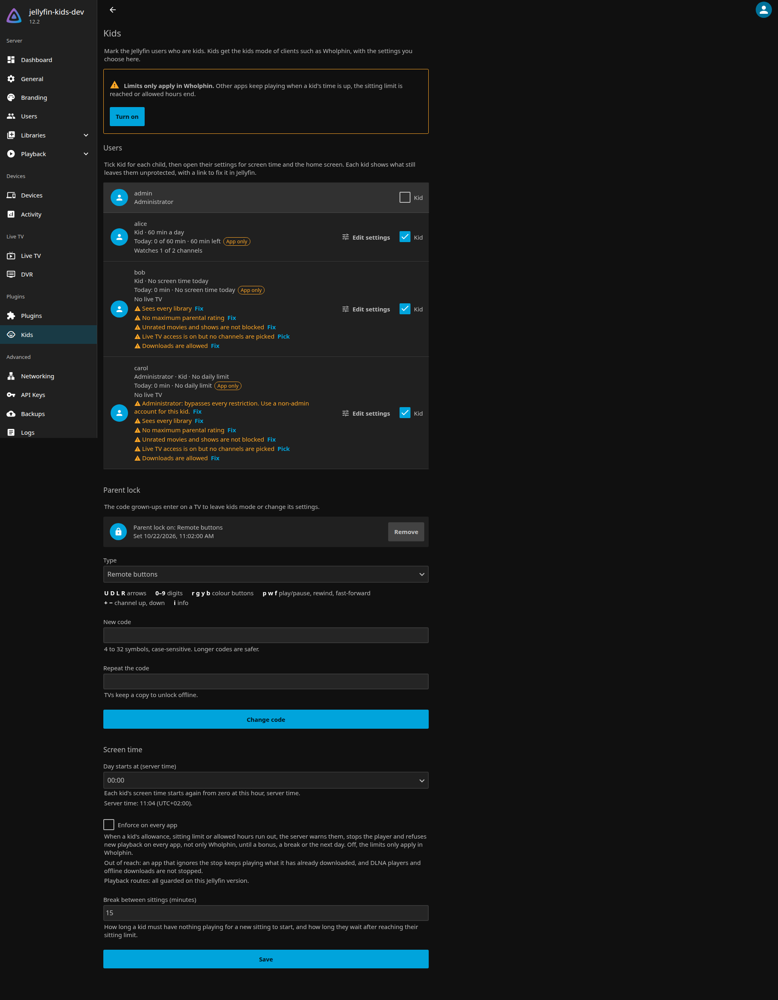
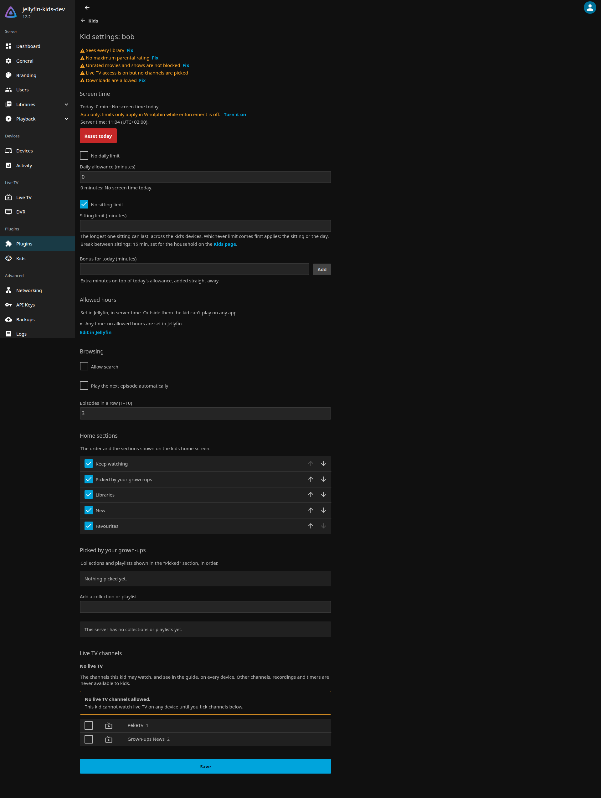
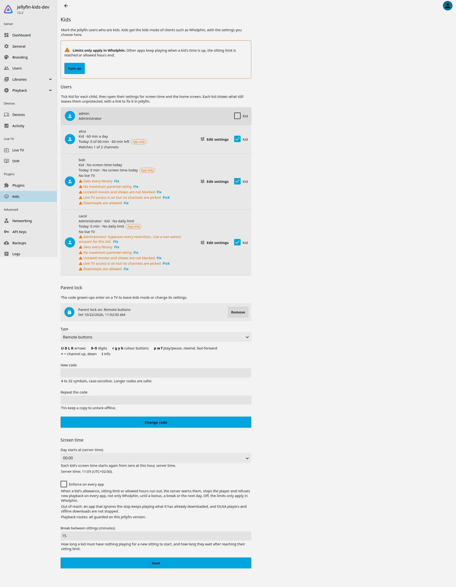
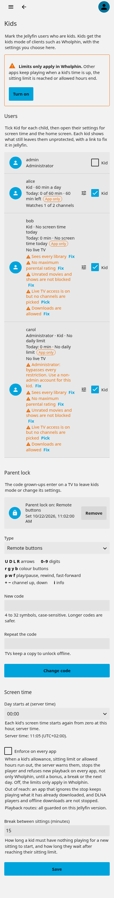

<div align="center">


### A kids mode for the whole house, set up once on your Jellyfin server.

**Mark who is a kid, pick one parent code and a daily allowance. Every TV and every app follows the same rules.**

[](https://github.com/aldoborrero/jellyfin-kids/actions/workflows/ci.yml)
[](https://jellyfin.org/)
[](https://dotnet.microsoft.com/)
[](LICENSE)

[Install](#install) · [What it does](#what-it-does) · [Screenshots](#screenshots) · [How it works](#how-it-works) · [Clients](#clients) · [API](#api) · [Development](#development) · [Roadmap](#roadmap)

<code>https://raw.githubusercontent.com/aldoborrero/jellyfin-kids/gh-pages/manifest.json</code>

</div>

---

Jellyfin already knows how to keep a kid's account safe: it limits libraries, maximum ratings, tags and
allowed hours for every app. What it doesn't have is the rest of a kids mode: knowing which accounts
belong to kids, a parent code that is easy to type with a remote, and a daily screen-time allowance that
holds across the living room TV, the bedroom TV and the tablet.

Jellyfin Kids adds those to the server. A parent sets it up once from the Jellyfin dashboard, and every
client that speaks its API picks it up. Screen time is counted from the server's own playback events, so
it counts no matter which app the kid uses. A kid's token can never change the rules, including their
own.

Nothing leaves your server: no telemetry, no accounts, no third-party services.

> [!NOTE]
> Early development. The plugin targets Jellyfin 12.x and is tested on 12.2.
> Peke for Jellyfin, a kids app for Android TV, is the reference client. The API is open to any Jellyfin client.

## Install

1. In Jellyfin, open **Dashboard → Plugins → Repositories** and add
   `https://raw.githubusercontent.com/aldoborrero/jellyfin-kids/gh-pages/manifest.json`.
2. Open **Catalog**, install **Kids**, and restart Jellyfin.
3. Open **Dashboard → Kids** to mark kids, set the parent code and choose daily allowances.

Updates appear in the catalog like any other plugin. See [docs/install.md](docs/install.md) for details
and for installing a release by hand.

> [!WARNING]
> **Updating to 0.0.6.0 cuts every kid's live TV** until you pick their channels under **Live TV channels** in
> Dashboard → Kids → the kid. This happens even with enforcement off; see [Live TV](#live-tv).

## What it does

| | |
|---|---|
| **Kid profiles** | Mark any Jellyfin user as a kid, with their own avatar, home sections, picks, search and autoplay settings. Warns when a kid account is an administrator, since admins bypass every check. |
| **Household parent code** | One code for the whole house, digits or remote buttons. Checked by the server, rate limited per device and per kid, and stored only as a PBKDF2 verifier. A right code gives a short-lived grant for changes. |
| **Daily allowance** | Minutes per day per kid, shared across devices. Counted on the server from real playback (paused time doesn't count, and a kid watching in a parent's session isn't charged). Parents can add bonus time for today, or reset today back to zero (logged). |
| **Enforcement on every client** (opt-in) | When a kid runs out of time, reaches their sitting limit or their allowed hours end, the server warns them, shows a message, stops the player, ends transcodes and cuts streams, and refuses new playback until a bonus, a break or the next day. Works with jellyfin-web and any other client, not only the kids app. Off until you turn it on; see [Enforcement](#enforcement). |
| **Live TV channels per kid** | Pick which live TV channels each kid may watch (for example the kids channels of an ErsatzTV tuner). On every client, a kid can only play, list and see the guide of their own channels, and never recordings or timers. Live TV counts as screen time. Always on, so kids have no live TV until you pick their channels; see [Live TV](#live-tv). |
| **Day start** | Choose the hour the day resets, with daylight saving handled. |
| **Offline playback** | Clients can report downloads watched offline. Reports can only add time, never remove it. |
| **Dashboard pages** | Everything above is managed from Jellyfin's own dashboard, no extra app needed. Each kid shows what still leaves them unprotected in Jellyfin (an administrator account, every library, no maximum rating, unrated movies and shows, live TV access, picked channels that Jellyfin's parental control hides, downloads) with a link to fix it, and a banner says when limits only apply in the kids app. |
| **Cleanup** | A deleted user's kid profile and usage go with them, and usage older than 90 days is pruned daily. |

## Screenshots

The Kids dashboard pages in Jellyfin 12.2 (development server, with sample kids).

<table>
  <tr>
    <td width="50%"><a href="docs/assets/screenshots/kids-page-dark.png"></a></td>
    <td width="50%"><a href="docs/assets/screenshots/kid-editor-dark.png"></a></td>
  </tr>
  <tr>
    <td align="center"><b>Kids page</b>: who is a kid, today's screen time, what still leaves each kid unprotected, with Fix links, the parent lock and household settings.</td>
    <td align="center"><b>Kid editor</b>: screen time, sitting limit, bonus and Reset today, allowed hours, home sections, picks and live TV channels.</td>
  </tr>
  <tr>
    <td width="50%"><a href="docs/assets/screenshots/kids-page-light.png"></a></td>
    <td width="50%" align="center"><a href="docs/assets/screenshots/kids-page-mobile.png"></a></td>
  </tr>
  <tr>
    <td align="center">Light theme</td>
    <td align="center">On a phone</td>
  </tr>
</table>

## Enforcement

Enforcement is off after installing or updating. Turn it on per household with **Enforce on every app** under
Screen time on the Kids dashboard page, which also sets the break between sittings and shows whether every playback
route could be guarded on your Jellyfin version. Or through the plugin configuration API:

```sh
curl -s -H "Authorization: MediaBrowser Token=\"$ADMIN_TOKEN\"" "$JELLYFIN/Plugins/d62ee188270c49d8b7b95e524fec2335/Configuration" \
  | jq '.EnforcementEnabled = true' \
  | curl -s -X POST -H "Authorization: MediaBrowser Token=\"$ADMIN_TOKEN\"" -H 'Content-Type: application/json' \
      -d @- "$JELLYFIN/Plugins/d62ee188270c49d8b7b95e524fec2335/Configuration"
```

`SittingBreakMinutes` (default 15) is how long a kid must have nothing playing for a new sitting to start.

With enforcement on, for kids only:

- 5 and 1 minutes before the allowance, the sitting or the allowed hours end, each playing app shows a notice.
- When one ends, the app shows a message, and about 5 seconds later the server stops it, ends its transcodes and
  live streams, cuts the streams it is sending and ends the playback on the server. If the app keeps playing, the
  server stops it again, at most every 10 seconds.
- New playback is refused: jellyfin-web shows "Playback of this media is not allowed", other routes answer 403 with
  `X-Application-Error-Code: PlaybackNotAllowed`. Browsing, search and the rest of Jellyfin keep working.
- A bonus, Reset today, the end of the break or the next day lifts it at once.

Limits: an app that ignores the stop keeps playing what it has already downloaded (about 35 seconds for a browser in
our tests). A stream address with no token and no device id can't be tied to a kid, and DLNA renderers and offline
downloads are out of reach. `GET /Kids/Info` reports whether every playback route could be guarded on your Jellyfin
version.

## Live TV

Jellyfin's own live TV permission is all or nothing, so the plugin adds a per-kid channel list: open the kid in
Dashboard → Kids and tick their channels under **Live TV channels**.

**After updating to 0.0.6.0, kids have no live TV until you pick their channels.** The channel rules are always on,
whether or not enforcement is: they are a content rule, like ratings. For kids only:

- Playing a channel that is not in their list is refused on every client (jellyfin-web shows "Playback of this media
  is not allowed"; other routes answer 403 with `X-Kids-Reason: liveTvChannel`).
- Jellyfin's own channel list and guide show only their channels; recordings and timers are refused.
- The kid's Jellyfin user still needs **Allow Live TV access** (the editor warns when it is off), and Jellyfin's
  ratings and "block unrated" settings still apply to channels and programs: the dashboard names each picked channel
  they hide from a kid, and how to fix it.
- Live TV counts toward the daily allowance and the sitting, and enforcement stops it like any other playback.

Kids clients read the kid's channels and guide from `GET /Kids/Users/{id}/LiveTv/Channels` and `/LiveTv/Programs`.
Limits: generic `/Items` lookups of a channel id and images are not filtered.

## How it works

Jellyfin Kids builds on what Jellyfin already does instead of copying it:

| Jellyfin keeps doing | Jellyfin Kids adds |
|---|---|
| Library access, parental ratings, unrated items, tags | Which users are kids, and their kids mode settings |
| Allowed hours (access schedules) | A daily allowance, bonus time and a sitting limit |
| Sign-in and authorization | A household parent code and short-lived parent grants |
| Playback sessions and events | Counting kids' screen time from those events, and stopping playback when it runs out |
| Playback and stream routes | A filter on those routes only, which refuses a kid who may not play now |
| Live TV (all or nothing per user) | Which channels each kid may watch, held on the playback, guide and recording routes |

Plugin data lives in a small SQLite database in the plugin's data folder. Admins and API keys are never
blocked, and disabling the plugin removes everything it enforces.

## Clients

Clients detect the plugin with the anonymous `GET /Kids/Info`, which lists the features the server
supports. Clients without kids mode keep working as usual.

- **Peke for Jellyfin** (Android TV): the kids client the plugin is built with: who's watching with each kid's
  avatar, kids home, the parent gate, the daily allowance and a per-sitting timer. In development.
- Any other client can use the same API.

## API

The client API lives under `/Kids` and is versioned (`ApiVersion` and `ApiMinorVersion` in `GET /Kids/Info`: the
major version changes only on breaking changes, the minor one on additions). The contracts:

- [Profiles and detection](specs/001-kids-plugin-foundation/contracts/kids-api-v1.md)
- [Parent lock and grants](specs/002-kids-parent-lock/contracts/kids-api-v1-parent-lock.md)
- [Daily allowance](specs/003-kids-allowance-tracking/contracts/kids-api-v1-allowance.md)
- [Session limit](specs/004-kids-session-limit/contracts/kids-api-v1-session-limit.md)
- [Enforcement and the sitting](specs/005-kids-enforcement/contracts/kids-api-v1-enforcement.md)
- [Live TV](specs/006-kids-live-tv/contracts/kids-api-v1-live-tv.md)
- [Reset today](specs/007-kids-dashboard-ux/contracts/kids-api-v1-reset.md)
- [Avatars, API 1.1 and channel ratings](specs/012-kids-avatar/contracts/kids-api-v1-avatar.md)

The design and the reasoning behind it are in [docs/plan.md](docs/plan.md).

## Development

Everything runs from the Nix devshell (`direnv allow`, or `nix develop`): the .NET 10 SDK, Jellyfin 12.x
from nixpkgs, jellyfin-ffmpeg and process-compose.

```sh
dev          # start the dev loop (process-compose up)
dev-reset    # forget the dev server's state
```

The dev loop:

1. `plugin` builds the plugin and installs it in `.dev/data/plugins/` with a `meta.json` made from
   `build.yaml`.
2. `jellyfin` runs the server on <http://127.0.0.1:8096> (`JELLYFIN_KIDS_PORT` picks another port, for example to
   run two dev loops: `JELLYFIN_KIDS_PORT=8196 dev -p 8197`), with its data, config, cache and logs under
   `.dev/`. It listens on localhost only; the Android emulator reaches it at `http://10.0.2.2:8096`.
3. `provision` finishes the startup wizard and creates the dev users: admin `admin` / `admin` and the
   kids `alice` and `bob` (`DEV_ADMIN_USER`, `DEV_ADMIN_PASSWORD` and `DEV_KIDS` change them). It also
   adds a Kids library with a generated test clip, and a live TV tuner with two channels, PekeTV and Grown-ups News,
   and their guide. The admin token is written to `.dev/admin.token`.
4. `livetv` serves those two channels as live MPEG-TS streams from jellyfin-ffmpeg, on ports `JELLYFIN_KIDS_PORT` + 10
   and + 11.

Editing anything under `src/` (or `build.yaml`) rebuilds the plugin and restarts Jellyfin, since
Jellyfin only loads plugins at startup.

Tests:

```sh
dotnet test                # unit tests
scripts/dev-check.sh       # checks against the running dev server: auth, answers, playback counting, pages, enforcement, live TV
```

Features are planned with [spec-kit](https://github.com/github/spec-kit) under [specs/](specs/), following
the project's [constitution](.specify/memory/constitution.md). Upstream sources used as reference
(Jellyfin and other plugins) are cloned into `.reference/`, which is not committed.

## Roadmap

- [x] Kid profiles and dashboard pages
- [x] Household parent code with server-side checks and grants
- [x] Daily allowance counted on the server
- [x] Per-kid sitting limit
- [x] Stop playback when time is up, on every client (opt-in)
- [x] Live TV channels per kid, with their guide
- [x] A dashboard that shows each kid's protection gaps, and Reset today
- [x] Kid avatars, and a warning when Jellyfin hides a picked channel from a kid
- [ ] Recommended restrictions in one step, an allowed-hours editor, and picks backed by Jellyfin collections
- [ ] Per-kid codes, viewing history, and export and import of plugin data

## License

The code is MIT. See [LICENSE](LICENSE).

The banner in [docs/assets/banner.svg](docs/assets/banner.svg) includes the Jellyfin logo from
[jellyfin-ux](https://github.com/jellyfin/jellyfin-ux), © the Jellyfin contributors, under
[CC BY-SA 4.0](https://creativecommons.org/licenses/by-sa/4.0/). The banner is shared under the same
license. Jellyfin Kids is a community plugin, not an official Jellyfin project.
