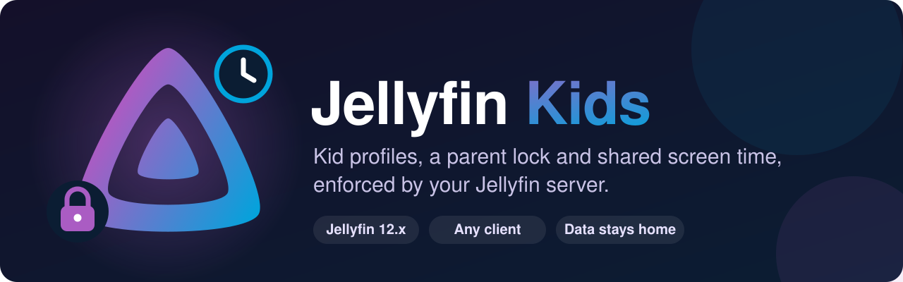

<div align="center">



### A kids mode for the whole house, set up once on your Jellyfin server.

**Mark who is a kid, pick one parent code and a daily allowance. Every TV and every app follows the same rules.**

[](https://github.com/aldoborrero/jellyfin-kids/actions/workflows/ci.yml)
[](https://jellyfin.org/)
[](https://dotnet.microsoft.com/)
[](LICENSE)

[Install](#install) · [What it does](#what-it-does) · [How it works](#how-it-works) · [Clients](#clients) · [API](#api) · [Development](#development) · [Roadmap](#roadmap)

<code>https://raw.githubusercontent.com/aldoborrero/jellyfin-kids/gh-pages/manifest.json</code>

</div>

---

Jellyfin already knows how to keep a kid's account safe: it limits libraries, maximum ratings, tags and
allowed hours for every app. What it doesn't have is the rest of a kids mode: knowing which accounts
belong to kids, a parent code that is easy to type with a remote, and a daily screen-time allowance that
holds across the living room TV, the bedroom TV and the tablet.

Jellyfin Kids adds those to the server. A parent sets it up once from the Jellyfin dashboard, and every
client that speaks its API picks it up. Screen time is counted from the server's own playback events, so
it counts no matter which app the kid uses. A kid's token can never change the rules, including their
own.

Nothing leaves your server: no telemetry, no accounts, no third-party services.

> [!NOTE]
> Early development. The plugin targets Jellyfin 12.x and is tested on 12.2.
> [Wholphin](https://github.com/damontecres/Wholphin) for Android TV is the reference client.

## Install

1. In Jellyfin, open **Dashboard → Plugins → Repositories** and add
   `https://raw.githubusercontent.com/aldoborrero/jellyfin-kids/gh-pages/manifest.json`.
2. Open **Catalog**, install **Kids**, and restart Jellyfin.
3. Open **Dashboard → Kids** to mark kids, set the parent code and choose daily allowances.

Updates appear in the catalog like any other plugin. See [docs/install.md](docs/install.md) for details
and for installing a release by hand.

## What it does

| | |
|---|---|
| **Kid profiles** | Mark any Jellyfin user as a kid, with their own home sections, picks, search and autoplay settings. Warns when a kid account is an administrator, since admins bypass every check. |
| **Household parent code** | One code for the whole house, digits or remote buttons. Checked by the server, rate limited per device and per kid, and stored only as a PBKDF2 verifier. A right code gives a short-lived grant for changes. |
| **Daily allowance** | Minutes per day per kid, shared across devices. Counted on the server from real playback (paused time doesn't count, and a kid watching in a parent's session isn't charged). Parents can add bonus time for today. |
| **Day start** | Choose the hour the day resets, with daylight saving handled. |
| **Offline playback** | Clients can report downloads watched offline. Reports can only add time, never remove it. |
| **Dashboard pages** | Everything above is managed from Jellyfin's own dashboard, no extra app needed. |
| **Cleanup** | A deleted user's kid profile and usage go with them, and usage older than 90 days is pruned daily. |

## How it works

Jellyfin Kids builds on what Jellyfin already does instead of copying it:

| Jellyfin keeps doing | Jellyfin Kids adds |
|---|---|
| Library access, parental ratings, unrated items, tags | Which users are kids, and their kids mode settings |
| Allowed hours (access schedules) | A daily allowance and bonus time |
| Sign-in and authorization | A household parent code and short-lived parent grants |
| Playback sessions and events | Counting kids' screen time from those events |

Plugin data lives in a small SQLite database in the plugin's data folder. Admins and API keys are never
blocked, and disabling the plugin removes everything it enforces.

## Clients

Clients detect the plugin with the anonymous `GET /Kids/Info`, which lists the features the server
supports. Clients without kids mode keep working as usual.

- **[Wholphin](https://github.com/damontecres/Wholphin)** (Android TV): kids home, the parent gate,
  the daily allowance and a per-sitting timer. Kids mode support is in development.
- Any other client can use the same API.

## API

The client API lives under `/Kids` and is versioned (`ApiVersion` in `GET /Kids/Info`). The contracts:

- [Profiles and detection](specs/001-kids-plugin-foundation/contracts/kids-api-v1.md)
- [Parent lock and grants](specs/002-kids-parent-lock/contracts/kids-api-v1-parent-lock.md)
- [Daily allowance](specs/003-kids-allowance-tracking/contracts/kids-api-v1-allowance.md)

The design and the reasoning behind it are in [docs/plan.md](docs/plan.md).

## Development

Everything runs from the Nix devshell (`direnv allow`, or `nix develop`): the .NET 10 SDK, Jellyfin 12.x
from nixpkgs, jellyfin-ffmpeg and process-compose.

```sh
dev          # start the dev loop (process-compose up)
dev-reset    # forget the dev server's state
```

The dev loop:

1. `plugin` builds the plugin and installs it in `.dev/data/plugins/` with a `meta.json` made from
   `build.yaml`.
2. `jellyfin` runs the server on <http://127.0.0.1:8096>, with its data, config, cache and logs under
   `.dev/`. It listens on localhost only; the Android emulator reaches it at `http://10.0.2.2:8096`.
3. `provision` finishes the startup wizard and creates the dev users: admin `admin` / `admin` and the
   kids `alice` and `bob` (`DEV_ADMIN_USER`, `DEV_ADMIN_PASSWORD` and `DEV_KIDS` change them). It also
   adds a Kids library with a generated test clip. The admin token is written to `.dev/admin.token`.

Editing anything under `src/` (or `build.yaml`) rebuilds the plugin and restarts Jellyfin, since
Jellyfin only loads plugins at startup.

Tests:

```sh
dotnet test                # unit tests
scripts/dev-check.sh       # checks against the running dev server: auth, answers, playback counting, pages
```

Features are planned with [spec-kit](https://github.com/github/spec-kit) under [specs/](specs/), following
the project's [constitution](.specify/memory/constitution.md). Upstream sources used as reference
(Jellyfin and other plugins) are cloned into `.reference/`, which is not committed.

## Roadmap

- [x] Kid profiles and dashboard pages
- [x] Household parent code with server-side checks and grants
- [x] Daily allowance counted on the server
- [x] Per-kid sitting limit
- [ ] Stop playback when time is up, on every client
- [ ] Recommended restrictions in one step, an allowed-hours editor, and picks backed by Jellyfin collections
- [ ] Per-kid codes, viewing history, and export and import of plugin data

## License

The code is MIT. See [LICENSE](LICENSE).

The banner in [docs/assets/banner.svg](docs/assets/banner.svg) includes the Jellyfin logo from
[jellyfin-ux](https://github.com/jellyfin/jellyfin-ux), © the Jellyfin contributors, under
[CC BY-SA 4.0](https://creativecommons.org/licenses/by-sa/4.0/). The banner is shared under the same
license. Jellyfin Kids is a community plugin, not an official Jellyfin project.
